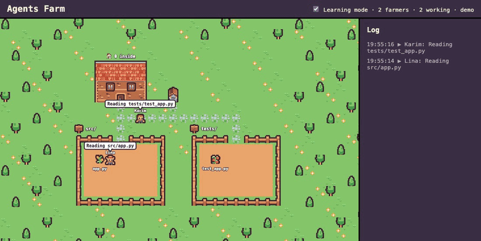

# Agents Farm

Watch AI coding agents work as pixel-art farmers.



Every time [Claude Code](https://claude.com/claude-code) reads a file, edits a file or runs a command, a little farmer on the page walks there and gets to work. Folders become fields, files become crops, and shell commands happen at the well. It's a live, friendly way to see what an agent is doing, and to learn what all those commands mean.

## Features

- **Live farm:** the farm grows as the agent works. Every new folder becomes a field and every new file becomes a crop.
- **One farmer per session:** each Claude Code session gets its own farmer with a friendly name like Lina or Omar. The same session always gets the same name.
- **Commands at the well:** when the agent runs a shell command, its farmer walks to the well and the command is shown above it.
- **Danger alerts:** risky actions like `rm -rf`, `git push --force`, `git reset --hard`, `sudo`, `chmod 777`, `curl ... | sh`, and reading or editing `.env` files get a red **!** and a red log line with the reason. Watch only: Claude is never blocked.
- **Learning mode:** every action is turned into plain English ("Reading README.md", "Running the tests") in the log and in speech bubbles. You can switch it off in the top bar.
- **Log panel:** a timeline of every action in your local time. Hover a line to see the full command.
- **Demo mode:** open the page with `?demo` to see it in action without Claude Code.

## How it works

```
Claude Code  ──hook──▶  hooks/send_event.py  ──HTTP POST──▶  FastAPI server  ──WebSocket──▶  farm page
(reads, edits,          (turns the hook data                 (checks for danger,             (canvas: farmers,
 runs commands)          into a small event)                  sends to every page)             fields, log)
```

1. **Claude Code hooks** run `hooks/send_event.py` before and after every Read, Edit, Write and Bash tool call, and when Claude stops.
2. **The hook** turns that into a small JSON event (who, what file or command, start or end) and sends it to the server. It never blocks Claude: short timeout, all errors ignored.
3. **The server** (`server/main.py`, FastAPI) checks each event for danger (`server/danger.py`) and sends it to every open page over a WebSocket.
4. **The page** (plain HTML, CSS and JavaScript, no frameworks) draws the farm on a canvas and moves the farmers.

The event format is described in [docs/events.md](docs/events.md).

## How to run

You need Python 3.10 or newer.

1. **Start the server** (in one terminal, from the project folder):

   ```
   python3 -m venv .venv
   source .venv/bin/activate
   pip install -r requirements.txt
   uvicorn server.main:app --reload
   ```

   You only need `python3 -m venv .venv` and `pip install` the first time.

2. **Start the farm page** (in a second terminal, from the project folder):

   ```
   python3 -m http.server 5500 --directory web
   ```

3. **Open the browser** at http://localhost:5500

   Open http://localhost:5500/?demo to see fake agents without the server.

4. **Use Claude Code in this folder.** The hooks are already set up in `.claude/settings.json`, so the farm comes alive as soon as Claude starts working.

Tip: after updating the code, do a hard refresh (Cmd+Shift+R on Mac, Ctrl+Shift+R on Windows/Linux) so the browser does not mix old and new files.

## Watch any project

To see Claude Code on **all** your projects, add the hook to your user settings in `~/.claude/settings.json`. Replace `/path/to/agents-farm` with where you cloned this repo:

```json
{
  "hooks": {
    "PreToolUse": [
      {
        "matcher": "Read|Edit|Write|MultiEdit|Bash",
        "hooks": [{ "type": "command", "command": "python3 /path/to/agents-farm/hooks/send_event.py", "timeout": 5 }]
      }
    ],
    "PostToolUse": [
      {
        "matcher": "Read|Edit|Write|MultiEdit|Bash",
        "hooks": [{ "type": "command", "command": "python3 /path/to/agents-farm/hooks/send_event.py", "timeout": 5 }]
      }
    ],
    "Stop": [
      {
        "hooks": [{ "type": "command", "command": "python3 /path/to/agents-farm/hooks/send_event.py", "timeout": 5 }]
      }
    ]
  }
}
```

If you already have a `"hooks"` section, add these entries to it instead of replacing it. Keep the server and the page running, then start Claude Code in any project: the farm shows that project's files.

## Project structure

```
hooks/send_event.py   the Claude Code hook: hook data -> event -> server
server/main.py        FastAPI server: receives events, sends them to the pages
server/danger.py      the rules for danger alerts
server/simulator.py   sends random fake events to the server (for testing)
web/                  the farm page: index.html, style.css, farm.js, agents.js,
                      learning.js, connection.js, and the pixel art in assets/
docs/events.md        the event format
```

## Credits

Pixel art by [Kenney](https://www.kenney.nl), released under [CC0](https://creativecommons.org/publicdomain/zero/1.0/) (public domain): [Tiny Farm](https://kenney.nl/assets/tiny-farm), [Tiny Town](https://kenney.nl/assets/tiny-town) and [Emotes](https://kenney.nl/assets/emotes-pack). Thank you, Kenney! See [web/assets/README.md](web/assets/README.md) for which tiles are used.

## License

[MIT](LICENSE)
